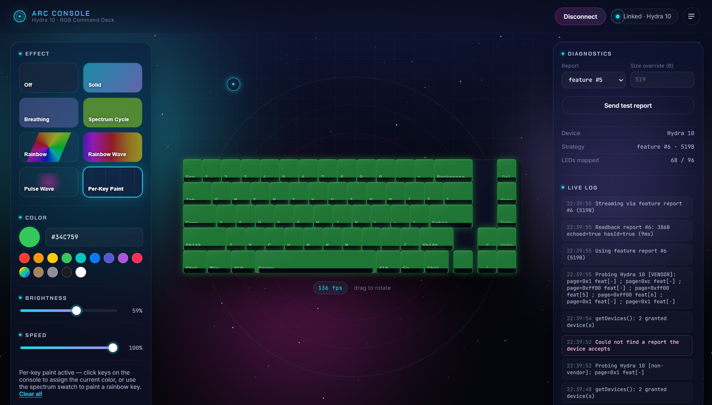

# Hydra 10 RGB Control

A desktop RGB control console for the [Portronics Hydra 10](https://www.portronics.com)
(SinoWealth 68-key, VID `0x258A` / PID `0x010C`) keyboard. Built with
Electron and WebHID, it streams lighting frames to the board in real time at
~30fps and renders a live 3D preview of the current effect.

Wired USB is fully supported. **2.4 GHz dongle support is experimental but
verified** on the Compx `3554:FA09` receiver (the same receiver family used by
the AULA F75); see [the dongle protocol](#24-ghz-dongle-protocol-verified).



> **Try it in your browser** — no install needed: open the
> [live in-browser demo](https://fahmimj.github.io/Hydra-10-RGB-Control/)
> in Chrome, Edge, or Brave (WebHID requires a secure context and a
> Chromium-based browser).

## Features

- **8 lighting effects** — Off, Solid, Breathing, Spectrum Cycle, Rainbow,
  Rainbow Wave, Pulse Wave, and Per-Key Paint, each with a live preview tile.
- **Per-Key Paint** — click keys directly on the on-screen keyboard to assign
  individual colors, or paint the rainbow spectrum onto a single key.
- **Color, brightness & speed** — a color picker, hex field, quick presets,
  and glowing sliders that apply live to the physical board.
- **3D keyboard preview** — drag to orbit; mirrors the exact frame data being
  sent to the board at 30fps.
- **Continuous streaming** — a Web Worker keeps the 30fps tick running even
  when the window is in the background, so lighting never falls back to the
  board's built-in animation.
- **Diagnostics panel** — live report strategy, report options, a test-report
  sender, device info, an FPS counter, and a scrolling log.
- **Settings persistence** — color/effect/brightness/speed are saved across
  sessions via `localStorage`; unexpected disconnects auto-reconnect.

## Requirements

- **Wired USB and the Compx 2.4 GHz receiver are supported.** The receiver
  (`3554:FA09`) uses a completely different protocol from the wired board and
  is auto-detected; see below. WebHID cannot see the keyboard over Bluetooth.
- Windows 10/11 (target platform)
- Google Chrome, Microsoft Edge, or Brave — Chromium-based browsers only,
  as WebHID is not supported in Firefox or Safari.
- A secure context: `http://localhost` or `https://`. The packaged Electron
  app runs over `file://`, which is always a secure context.

## Usage

1. Download the latest installer or portable build from the
   [Releases](../../releases) page.
2. **Plug the keyboard in with the USB cable (wired mode)**, or insert the
   2.4 GHz receiver and switch the board to wireless mode.
3. Launch **Arc Console** and click **Connect keyboard**.
3. Choose the Hydra 10 (or its receiver) in the device picker.
4. Pick an effect, adjust color/brightness/speed, and paint individual keys
   directly on the 3D keyboard.

If multiple devices are connected, a menu lets you select which one to
control. Any non-Hydra HID device is always ignored.

### 2.4 GHz dongle (experimental, verified on hardware)

The receiver is a **separate USB device** (`Compx 3554:FA09`, product
`Hydra 10`) with its own report map, and it does **not** speak the wired
519-byte feature protocol. It is auto-detected by VID/PID.

1. Insert the receiver and switch the board to **2.4 GHz mode**.
2. Open **Diagnostics** and tick **Dongle mode** (VID/PID default to
   `3554`/`FA09`; only change them for a different receiver).
3. Tick **Allow RGB writes over 2.4 GHz** and confirm the prompt.
4. Connect and choose an effect.

Writes stay blocked until step 3. The app only ever sends lighting command
`0x88`; it **never** sends the config command `0x04`, which writes
non-volatile storage and has been confirmed to stop keyboards typing.

#### 2.4 GHz dongle protocol (verified)

Decoded from the public [keylux protocol notes](https://github.com/SibteProf/keylux/blob/main/docs/PROTOCOL.md)
and verified here on 2026-11-09 by lighting LED `0x37` (the `9` key) cyan on a
Portronics Hydra 10 through the receiver. The full-board 8-chunk path and the
flicker fix below were verified on 2026-11-10.

- **Interface:** interface 1, vendor usage page `0xFF02`.
- **Channel:** HID **output report `0x13`**, 19-byte payload (20 bytes on the
  wire including the report ID).
- **Command:** `0x88` (live lighting) only.
- **Chunking:** 14 payload bytes per chunk, ~13 ms apart.
- **Frame:**

  ```
  byte 0      0x13 report ID
  byte 1      0x88 command (lighting)
  byte 2      total chunks in this message
  byte 3      chunk index (0-based)
  byte 4      0x10 + payload length in this chunk
  bytes 5..18 payload, zero padded
  byte 19     checksum = sum(bytes 0..18) & 0xFF
  ```

- **Payload:** a sequence of `[R, G, B, count, ledIndex...]` groups.
  Solid cyan on LED `0x37` is `13 88 01 00 15 00 ff ff 01 37 … e7`.
- **LED indices** are the same matrix indices the wired protocol uses
  (`0x37` = `9` on this 68-key layout).
- **All 96 LED slots are covered**, exactly like the wired path: the 68 mapped
  keys plus the 28 unmapped slots held at black. Animation frames carry only
  the 68 key LEDs (cheaper, so they can run faster), while a full 96-slot
  keyframe is sent every second. That keeps the keyboard's own firmware effect
  from flashing through on the unmapped slots.

The 7-byte feature report `#6` on usage page `0xFF04` is a **trap**: it uses
the wired report ID but is only a status report. The app never writes to it.

The link is throughput-limited. Pacing is budgeted at 60 chunks/second, below
the measured clean ceiling of ~64. In practice:

| Content | Chunks | Wireless rate |
| --- | --- | --- |
| Uniform effect (Solid, Breathing, Spectrum) | 6 | ~10 fps |
| Multi-colour effect (Rainbow, Pulse) | 7–10 | ~6–9 fps |
| Full 96-slot keyframe | 8–10 | once per second |

Wired remains ~30 fps. A smooth whole-board animation should still use the
cable; static colours and sparse effects work well over radio.

If a different receiver exposes no output report `0x13`, the app refuses to
write rather than probing unknown reports. Do **not** force other report IDs —
that risks writing into the keyboard's config zone.

## Development

```sh
npm install
npm start           # run the app
npm run dev         # run with dev flag
```

### Building the installers

```sh
npm run dist:win    # produces NSIS installer + portable exe in release/
```

## Project structure

| File | Purpose |
|---|---|
| `main.js` | Electron main process — window setup, WebHID permission grants. |
| `core.js` | Protocol engine (`window.RGB`) — connect, report detection, effects, packet builder, streaming. |
| `ticker.js` | Web Worker for background-tab 30fps ticking. |
| `ui.js` | Presentation layer — HUD, 3D keyboard, diagnostics, device picker. |
| `index.html` / `style.css` | Markup and the neon-ing theme. |

## Troubleshooting

- **"WebHID not supported"** — use a Chromium-based browser or the packaged
  app; WebHID requires a secure context.
- **Keyboard doesn't appear / no device found** — use a Chromium-based
  browser or the packaged app; WebHID requires a secure context. For the
  2.4 GHz receiver, run the read-only HID inspector and enter its PID.
- **Keyboard doesn't light up** — confirm your board is the Portronics
  Hydra 10 (wired VID `0x258A`, PID `0x010C`) and try the test report buttons
  in the Diagnostics panel. Over 2.4 GHz, confirm the receiver is
  `3554:FA09` and that **Dongle mode** plus **Allow RGB writes** are ticked.
- **Preview works but board is dark** — check that the status pill shows
  `Linked`; if the strategy was auto-negotiated as an output report, the
  diagnostics panel will show which report is in use.

## Credits

The key-to-LED mapping and protocol details are based on MRtojisan's
[portronics-hydra-10-SignalRGB-Plugin](https://github.com/MRtojisan/portronics-hydra-10-SignalRGB-Plugin) —
an unofficial SignalRGB plugin for the Portronics Hydra 10. Check it out if
you want full desktop synchronization and game sync via SignalRGB.

The 2.4 GHz receiver protocol was decoded by
[SibteProf/keylux](https://github.com/SibteProf/keylux) — see its
[`PROTOCOL.md`](https://github.com/SibteProf/keylux/blob/main/docs/PROTOCOL.md).
Without that write-up this dongle path would have cost another bricked board.

## License

[MIT](LICENSE)